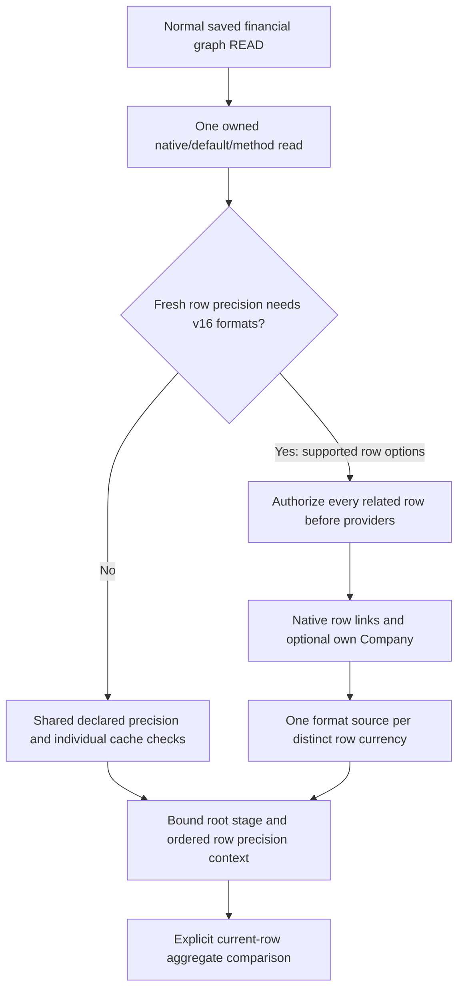

# Co-owned direct advance rounding context — batch151–154

This DEV checkpoint connects saved row/cache/currency inspection to the existing
advance aggregation comparison. It does not install a provider or run a saved
invoice controller. No site, schema, invoice, Company, cache or authority write
is introduced. Version evidence concerns the pinned ERPNext/Frappe revisions,
not full installed16 or SDK acceptance.

## API and shared ownership

`SavedCalculationDefaultsService.capture_advance_rounding_context(invoice_name,
erp_major=..., doctype="Sales Invoice"|"POS Invoice")` returns protected
`SavedAdvanceRoundingRead` with one root `total_advance` stage, exact original
direct/reference precision-cache samples, and complete ordered row precisions.
The standard advance table must be present; it may be empty.

The acquisition extends the existing root rounding stage. `ChildAcquisition`
can borrow that exact authorized numeric graph; its normal standalone path is
unchanged. It reuses the child link/Company/format readers and metadata policies.
The same parent service still owns connection validation, rollback/close, final
source/actor/permission/cache checks and one localized display summary.

There is no second parent capture, transaction, SQL transport, cleanup pipeline,
public RPC, hook or writer. Existing sixteen capture method ASTs are unchanged;
the explicit advance operation is the seventeenth. Other acquisition modes do
not start observing these advance caches or formats.

## 151: complete row precision and original cache observations

Every advance row is selected in native membership/index order, including rows
whose allocated amount is NULL. The controller evaluates row precision before
calling `flt`, so a NULL amount does not eliminate its precision dependency.

Inspect only the exact initial authorized direct row and embedded reference.
Record document/container identities and selected precision slots using the
existing built-in dictionary access helper; never invoke `precision()` or fill a
cache. Check both original slots through callbacks and cleanup. Absent slots
remain absent; present values must exactly match fresh precision, including
integer type. Equal digits do not validate the wrong currency.
Allocated fields outside Currency/Float/Percent fail before providers/SQL;
non-numeric fields cannot produce a context with an undefined row precision.

Configured metadata/site precision is resolved once for the whole row group,
while each cache is checked separately. An empty advance table has no row
precision/cache/format dependency. Fresh source comparison remains separate from
attesting an active controller's later precision call or cache population.

## 152: lazy direct-row currency formats

Only when nonempty rows require fresh v16 Currency format precision, acquire the
existing narrow native child links. Supported options are:

| Applied field option | Saved/native source |
| --- | --- |
| `currency` | Nonempty own row currency, otherwise saved parent invoice currency |
| `Company:company:default_currency` | Own row Company only; never an invoice-Company substitution |

A missing own Company resolves to no currency. Locale-only fallback requires
the captured currency-format Check to be disabled; no Currency(None) lookup is
made. Missing/NULL/blank row currency and missing own Company retain their native
presence/value distinctions. In-memory `parent_doc` fallback is not guessed.

Authorize all selected own Companies and related Currency/Language/System fields
before any child/format metadata provider. `FormatAcquisition` gains internal
deferred metadata preparation for this group; its default behavior is preserved.
The owned native defaults read necessarily precedes this lazy decision, as in
existing field-stage acquisition.

Sample every consumed row/parent field-currency slot before providers can warm a
later row's cache. Recheck through root-stage format callbacks and cleanup.
Same-currency rows share one initial format source and source rechecks; their
own link/Company observations remain separately checked. Tests count initial
source loads, not just equal output hashes. This is not a live latency benchmark
or a claim that all ORM/validation/query costs have been minimized.

## 153: bind the existing aggregate comparison

`AdvanceAggregateCalculation(stage, rows, advance_context=context)` accepts the
new same-source context. Require exact root stage/defaults/version and complete
row order. Round each row with its own captured precision, retaining distinct
row currencies/digits, NULL behavior, Python int0 sum semantics, root precision,
exact result type/float bits and ordered precision/setting traces.

`row_precisions` exposes the complete protected sequence. Legacy `row_precision`
is the common integer when all rows agree, otherwise None (also for no rows).
Supplying no context preserves the old behavior and its uncaptured16 fallback
refusal. A context is consistency evidence, not authority to mutate/submit an
invoice or proof of committed/executed controller origin.

The controller prefix is compared using installed15/pinned16 method bodies and
actual numeric helpers on unpersisted synthetic objects. The test stops at root
`total_advance` assignment. Invoice limits, FX, paid/outstanding/write-off,
advance lookup/matching/relinking, settlement and fiscal XML remain outside it.

## 154: standard metadata coverage and remaining party-currency source

The primary15 and16 Sales Invoice Advance definitions use
`party_account_currency` for `allocated_amount`. It must not be silently treated
as `currency`. Tests explicitly preserve:

- Version15 site/default number-format precision, without row format discovery.
- Configured16 currency precision, without unused row format dependencies.
- Unset16 precision: explicit `advance_rounding_party_currency_source_required`
  refusal before child/format providers, until the correct native source exists.

Therefore this checkpoint closes direct `currency` and own-Company format paths,
not the standard unset16 party-currency path. No setting is automatically filled
to bypass that missing proof. The primary metadata oracle is unchanged.

The next source step must prove optional own-row party currency and physical
column presence/absence, then the saved parent's party-account currency and its
normal field READ on this same graph/handle. Reuse the existing parent-party link
reader, shared bounded projections and row/parent cache semantics; preserve old
financial/link profile bytes. Compare the actual pinned helper's parent metadata
guard and fallback order. Only then admit that format branch into this context.

Complete tax/discount/GL/VAT/FX/advance/XML parity, active provider/controller and
transaction provenance, worker/custody integration, dead-code/performance review,
installed15/16 and SDK acceptance remain before separately approved fictional-
Company rehearsal and adoption/cancellation. All authority traffic remains
forbidden, including Sandbox/Simulation. LIVE retains the separate Phase-1
address hotfix. Executed evidence is recorded in [STATUS.md](STATUS.md).

See [CALCULATED_TOTALS.md](CALCULATED_TOTALS.md),
[CHILD_FIELD_FORMAT_ACCESS.md](CHILD_FIELD_FORMAT_ACCESS.md),
[CHILD_CACHE_OBSERVATION.md](CHILD_CACHE_OBSERVATION.md) and [PLAN.md](PLAN.md).
