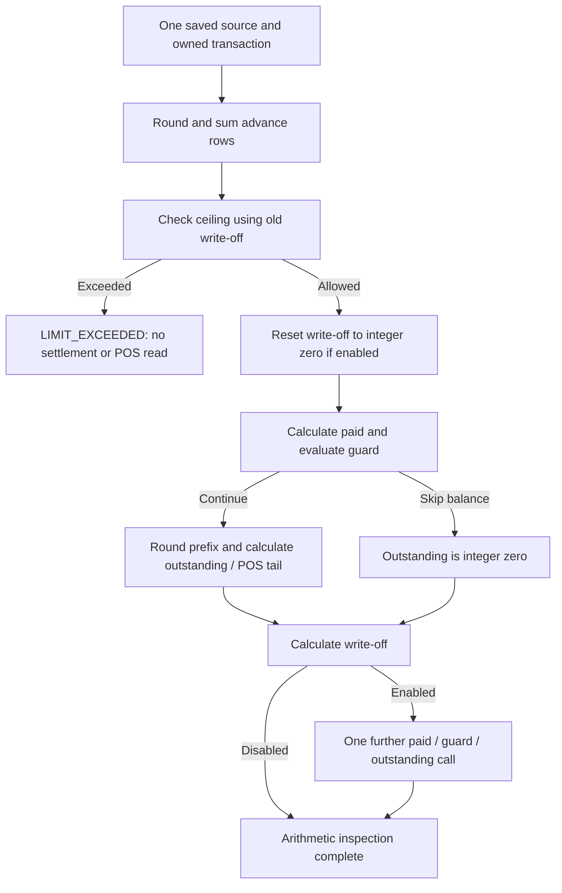

# Connected advance and settlement inspection — increment 193

This development-only bundle closes one arithmetic inspection path. It is not
installed on any working site, and it does not establish advance allocation,
GL/VAT correctness, fiscal acceptance or complete ERPNext 16 compatibility.

## Ten consecutive steps

1. Inspect the actual15 and pinned16 `calculate_total_advance` call order.
   The ceiling consumes the old write-off; its optional reset happens later.
2. Extract the advance row-precision lifecycle into `AdvanceRoundingStageMixin`.
   Existing advance readers and the new combined reader share the same code.
3. Reuse complete saved row aggregation and its per-row precision evidence.
   Preserve historical reference names; do not search, repair or relink them.
4. Pin the ceiling decision and bind it to the settlement's exact numeric graph,
   method, owner, party currency, metadata and precision/cache observations.
5. Derive only the aggregate assignment and conditional integer-zero write-off
   reset. Keep paid rows and other first-call inputs fixed to the saved source.
6. Reuse the bounded outstanding/write-off planner. Include the write-off call
   following an internal/return guard and its one guarded re-entry when enabled.
7. Add a single owned acquisition and internal capture operation, with lazy POS
   dependencies. An exceeded ceiling returns no settlement plan or POS lookup.
8. Compare the full actual15/pinned16 call tree on one synthetic document, plus
   access denial and native/getter/cache drift through the closing boundary.
9. Run focused existing regressions and check the offline manifest, source
   isolation and unchanged existing capture method bodies.
10. Record results, remaining gates and a reviewable DEV commit. Publish only
    the development branch; installation, Bench changes and authority I/O stay
    prohibited.

## Contract and ordering

`capture_advance_settlement_context` is internal, unwhitelisted and unregistered.
It accepts only the saved Sales Invoice identity, ERP major and two bounded
hypothetical append labels. It uses the existing one-message localized display
boundary and static English internal diagnostics. No new UI strings are added.

`SavedAdvanceSettlementPlan` has two arithmetic outcomes:

| Outcome | Meaning | Downstream effects represented |
| --- | --- | --- |
| `LIMIT_EXCEEDED` | Positive ceiling is strictly below aggregated advances | None |
| `CALCULATED` | The existing arithmetic plan can be reconstructed | First outstanding, write-off, optional one re-entry |

Neither outcome is `PASS`, ZATCA acceptance or permission to allocate an advance.
The inspection never modifies the stored `total_advance` or write-off even if
they are stale. The plan holds derived values alongside the original snapshot.
Native DECIMAL observations remain intact; temporary float arithmetic follows
the ERP reference adapter. It does not define XML amount formatting or change
the separate Decimal/XML boundary.

The first paid calculation retains saved native inputs. Its balance prefix may
consume calculated advance/reset values only with a checked, same-owned
`AdvanceLimitCalculation`. Removing that proof does not downgrade those values
to saved evidence. CALCULATED row/ceiling inputs cannot enter this saved pipeline.

For a guard that skips the balance, the primary still calls write-off afterwards.
If enabled, write-off uses the integer-zero outstanding result and requests one
more paid/guard call. No balance prefix or unused POS dependency is fabricated.
The consolidated POS tail can also enable automatic write-off after the initial
reset gate. Preserve that order; do not retrospectively reset the old write-off
or assume the last outstanding amount must be zero.

Cancelled documents remain refused by the existing aggregation contract. They
are not treated as zero advances or a completed settlement. The ordinary saved
settlement operation retains its previous inspection scope.

## Evidence and limitations

Validation completed: **464 distinct tests passed**, comprising **450 local**
and **14 private-SQL** cases. Eleven cases are new. The selected node list was
deduplicated; the three extra manifest checks overlap two earlier local cases.
The full manifest contains 162 local and 57 private suites; this increment does
not claim that every suite in that manifest was rerun.

| Reviewed scope | Result | Log |
| --- | --- | --- |
| Existing advance precision, write-off profile and settlement projections | 88 passed /124.23s | `/tmp/zatca-advance-integration-local.log` |
| Existing defaults access, shared graph and selected guard tests | 290 passed /2.87s | `/tmp/zatca-advance-shared-regression.log` |
| Existing aggregate kernels | 71 passed /497.06s | `/tmp/zatca-advance-aggregate-regression.log` |
| Fixed manifest | 3 passed, two overlap /0.10s | `/tmp/zatca-advance-manifest.log` |
| New ordinary15/16 complete call trees and detached/tampered proof rejection | 2 passed /845.70s | `/tmp/zatca-advance-chain-ordinary.log` |
| New foreign return16 and consolidated POS15 complete call trees | 2 passed /758.69s | `/tmp/zatca-advance-chain-pos.log` |
| New guarded16, exceeded ceiling16 and empty advances16 | 3 passed /748.78s | `/tmp/zatca-advance-chain-guards.log` |
| New field denial, native drift, close-cache drift and cancelled document | 4 passed /792.73s | `/tmp/zatca-advance-chain-denials.log` |
| Existing late-default and consolidated-limit planner | 2 passed /611.71s | `/tmp/zatca-advance-existing-plan-regression.log` |
| Existing distinct advance row-currency formats | 1 passed /8.85s | `/tmp/zatca-advance-row-format-regression.log` |

Tests ran only under the fixed offline guard, with NEW private TCP-disabled
MariaDB fixtures. Test groups ran concurrently; their durations must not be
summed into an end-user latency claim. The connected evidence reconstruction is
currently expensive and must be reduced before invoice-save integration.
All 24 existing capture methods retain their prior AST bodies. Changed Python
files parse and `git diff --check` passes. The live address hotfix hash remains
`d4360df7195ac4e3e63d74f005c000a3adadaa55caa7681cd1de1b058d4f7f01` at live
HEAD `ba51f2587763a4e9db045f57e1b8ee2bc29ea77c`. The pre-existing live
`customer_zatca_tooltips.js` modification was preserved and is outside this DEV
bundle; the live worktree is not claimed clean.

The reference bodies are installed15 and pinned16 source excerpts, not a full
installed16 lifecycle. Synthetic controller documents are never persisted.

Reference revisions: ERPNext15 `572d8530b6258231e31f294474cc1818f693d10b`,
Frappe15 `7b430f5eec8c0537f2f0cde9d30e175ae9068647`, ERPNext16
`ade850bbd6a7412e9994a9637d2c5c713771632a` and Frappe16
`e8d41dd0061a32ee781caefe5d0b0d2bb7c15362`. The existing oracle/fixture
integrity checks remain in effect; these are pinned references, not a claim
about every later15/16 release.

The remaining release gates include deriving earlier item/tax/discount/FX totals,
historical/partial/multiple advance eligibility and allocation, GL/VAT/XML
reconciliation, POS Invoice lifecycle integration, concurrency, trusted runtime
provider/cache provenance, XML/signature/QR/SDK reference acceptance, and fresh
install/migration/UI checks on separately approved isolated15/16 benches.

The new operation remains an inspection tool. Do not put its repeated evidence
reconstruction on invoice save or polling paths without runtime profiling and
the remaining integration work. No invoice latency improvement is claimed.
