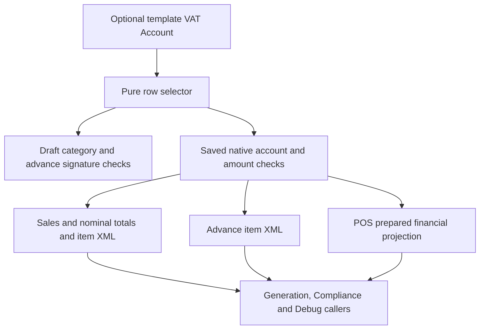

# Explicit Item Tax Template VAT selection — increment220

Development only, 2026-11-15. No working site, database, schema, invoice,
credential, worker or authority API was changed. The optional field is a fixture
for a future separately approved installation/migration; it has not been
installed on any site. This is unsigned financial XML evidence, not acceptance
by ZATCA, an SDK run or a complete ERP document/GL lifecycle.

## Configuration and scope

`Item Tax Template.custom_zatca_vat_account` is an optional Account Link, labelled
**ZATCA VAT Account** (Arabic: **حساب ضريبة القيمة المضافة لزاتكا**). It declares
which row owns that template's existing category and exemption reason. It is
not an initial ICV setting, an account-name heuristic or a new percentage field.
There is no automatic default, backfill, fetch or assignment.

| Input | Policy |
| --- | --- |
| Field absent/NULL/blank | Preserve each route's legacy selection and restrictions |
| Explicit account | Exactly one matching row; unique, nonempty account names |
| Other template rows | Numeric, finite zero overrides only; do not delete or rewrite them |
| Selected zero VAT | Preserve zero; require the appropriate existing category/reason |
| Other positive/negative tax or charge | Refuse; do not discard it or add its rate to VAT |
| Multiple applicable VAT components on one item | Still outside this selector's scope |
| Invoice-level multi-account source without item templates | Existing restrictions remain |

Templates retain category/reason ownership. Account type Tax or legacy blank-type
Liability is only account eligibility, not proof of VAT ownership. The selector
provides the declaration; saved native rates and money must corroborate it.
Template-save checks preserve the Company enabled/Phase-2/explicit category-rate
setting gate. Inside that gate, the selected Account must belong to the company,
be a leaf and meet the existing eligibility policy. XML always verifies the
opted-in source even when draft category-rate enforcement is disabled.

## Shared implementation and paths

- `ksa_compliance/item_vat_selection.py`: pure role selection, preserving physical
  row identity and zero rates, without document reads or mutation.
- `ksa_compliance/declared_vat_scope.py`: one extracted account/rate/after-discount
  comparison shared by POS and selected Sales sources; unchanged arithmetic from
  increment218, no framework dependency.
- `template_vat_source.py`: framework/localization adapter and one builder's
  bounded template context. Legacy reads remain owned by their existing caller;
  the new checked context is not a trusted document or credential snapshot.
- `tax_error.py`: category/rate/reason, advance signature and expected-account
  selection use the same row. Parent category/reason settings remain.
- `xml_tax_data.py`, `create_xml_final_part.py`, `createxml.py`: selected Sales,
  nominal, advance-line and legacy document-allowance consumers use that row.
- `pos_financial_xml.py`: selected rows enter the existing immutable, reconciled
  POS rendering projection. Single-account opt-in also verifies native evidence.
- Submit/background guards use the selector. Their included-price/template
  restriction relaxes only after complete opted-in source verification; no
  declaration retains the old refusal. Existing generator/Compliance/Debug
  composition is retained; no request is sent as part of this development.

The existing public native-rate API, VAT group arithmetic, signing, QR encoding,
UUID/ICV/PIH policies, accepted artifacts and authority endpoints are unchanged.
First-invoice behavior receives no counter field or new sequence policy here.
Advance references and legacy reference-tail calculations remain their existing
separate rules; this increment selects VAT for the primary invoice lines and
advance category/rate checks, not a rewrite of settlement provenance.

## Saved source and discount checks

Every invoice tax account must be covered by an item's chosen VAT row. Duplicate,
compound, deducted or unexplained extra accounts fail, including unexplained
zero rows. Unselected companion templates must have a single unambiguous row.
Template/company ownership, classification, finite values and selected rate
precision must agree with the XML representation.

v15 uses the physical item's account map then the corresponding invoice rate.
v16 requires exact, complete saved item-row/tax-row pairs, including zeros;
empty/partial/duplicate/dangling pairs cannot use a stale v15 fallback. All other
invoice accounts must have native zero rates for that physical item. Aggregated
item-code JSON does not join different items with the same code.

Compare required `tax_amount_after_discount_amount` per account, their sum and
recorded document VAT. SAR base rows/header also reconcile. Foreign base header
conversion remains independent of individually rounded rows, as in218. XML
subtotals still group by category/rate/reason, not Account Head. Group-rounding
versus recorded ERP discrepancies refuse generation rather than repairing money.

Use ERP's final `net_amount`/`base_net_amount`. An ordinary header discount
requires native allocation evidence; no second distribution or header allowance
is introduced. Net Total and Grand Total discounts, inclusive/exclusive prices,
returns, quantities and currencies are compared against equivalent single-row
sources. Pinned ERP15/16 allocation methods execute under explicit framework
boundaries; subsequent tax observations are simulated, not a full recalculation.

**Historical220 foreign Sales limitation** (addressed for native missing-helper
inputs in [increment221](SALES_CURRENCY_BINDING.md)): the existing Sales line helper uses a document's
`company_currency` binding. The new selected scope requires that binding to be
SAR for foreign currency. If absent/other, refuse with a translated actionable
message; do not guess or mutate the document. POS has its own currency policy and
does not need that extra document attribute. Broader native Sales currency-source
integration remains a release task.

## UI and messages

The Account selector appears for enabled Phase-2 Item Tax Templates with multiple
rows, or an already selected account. It remains optional and filters to current
company, leaf accounts and current template rows. Explicit selection never
rewrites VAT or override rates. Legacy non-standard automatic zeroing now requires
Phase-2 and the explicit Company category-rate enforcement setting. Phase-1,
disabled or unknown phase, and enforcement-off states do not rewrite rates.

Company state is request-bound: a late response for a previous company cannot
change the current form, including optional-setting lookup failures. Schema
absence retains the existing legacy phase-field fallback. Label, description and
source-error display keys have real Arabic catalog entries. Account identifiers
are not translated. Typed errors propagate without nested wrapping; Debug keeps
one summary and one English diagnostic when the source already logged it.

## Observable compatibility and evidence

With no selector, existing output/rejection policies remain. The separate original
pre-development240-case oracle still records91 identical/117 changed/32 blocked
from earlier increments; these are not relabelled as parity or approved changes.

The opt-in difference is explicit: two100-net lines whose multi-row templates
start with a zero override historically produce Sales VAT0 and payable200.
Selecting their actual5/15 accounts produces VAT20 and payable220, matching the
saved ERP values. The invoice is not changed. Existing POS refuses the ambiguous
multi-row form; the declared, reconciled form now emits successfully. Selecting
an actual zero account never substitutes a positive rate. New discrepancies or
unsupported roles fail rather than silently falling back.

Validation:13,032 cases passed in the58-suite guarded run, with four additional
Debug-boundary cases passing later:13,036 distinct cases, including588 new. The
focused new-feature run passes588; the final affected-source/readability review
passes1,659 cases without adding them again to the distinct count. Six browser suites pass1,184 synthetic cases:
Debug100, Debug lifecycle164, Company messages108, Company form292, device128
and template VAT392. The manifest lists192 local and57 private suites; it was
not run as a whole. Logs: `/tmp/zatca-declared-220-regression-final.log`,
`/tmp/zatca-declared-220-focused.log`; structural evidence:
`/tmp/zatca-declared-220-structure.json`. Tests cover simulated
15/16 source shapes, equivalent single-row XML, literal old/new money, nominal
and advance consumers, native Net/Grand allocation probes, corrupt sources,
company/rule/account gates, localized errors and template UI races. Template-save
and Debug boundaries are simulated; no tenant SQL or full manifest run occurs.
Existing original financial fixtures remain frozen. Installed15/16 fresh/upgrade
lifecycle, all fiscal/SDK scenarios, trusted source/settings/credential custody,
transaction/GL/ICV recovery and separately approved fictional-client rehearsal
remain required before release. This bundle does not establish global readiness.
