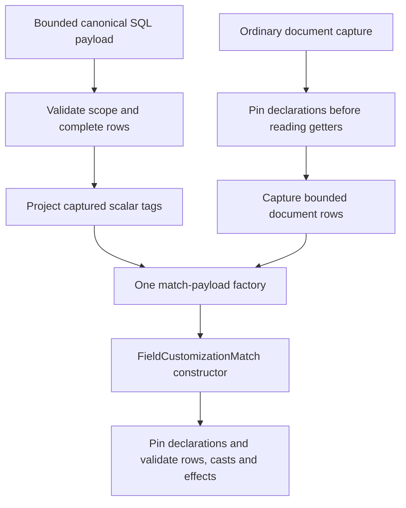

# Metadata capture composition and cost — increment 194

This development-only change addresses the repeated reconstruction identified
after increment193. It is not installed on a working bench and does not issue
authority requests, change settings or alter invoice amounts.

## Change and caller map

`SelectedMetadataRows` formerly decoded its bounded SQL payload, validated rows,
constructed temporary document facades, and called the general document capture
function. That function independently pinned the declarations again before
reading the facades. The final match constructor then pinned them again.

SQL capture now projects its privately decoded Custom Field tags directly into
the original match shape. The complete SQL observation still retains `idx` and
`is_virtual`; both are checked before the narrower projection. Property Setter
rows already have the required match shape. Both acquisition paths use one
`_match_captured_rows` factory and the unchanged `FieldCustomizationMatch`
constructor. Its metadata, row, bound, cast and declared-effect checks remain.

The public `reconcile_field_customizations` signature and pre-getter validation
remain intact. All 25 existing calculation capture method bodies are unchanged.
The removed private `_document` facade had callers only in this SQL constructor,
as checked across repository Python, JavaScript, JSON and Markdown. No public
entry point or runtime file was removed. This is one verified cleanup, not a
claim that all legacy code is unused or that all parallel paths are consolidated.

There is no global cache, validation bypass, new serializer or change to the
bounded streaming canonicalizer. No messages or error codes were added; the
existing aggregated localized display boundary and English internal diagnostics
remain in place.

## Measurements

Baseline revision: `bdb3279`. Measurements use synthetic data under the offline
guard. Temporary profiling scripts and reports live under `/tmp`, not in runtime
hooks. The alternating A/B benchmark restores every patched method and runs
historical constructor code only inside its own process.

| Scope | Before | After | Interpretation |
| --- | --- | --- | --- |
| Alternating A/B CPU, median of three runs of 20 constructions | 0.763479s | 0.551691s |27.7% less CPU for this metadata reconstruction workload |
| Full selected advance/settlement15 test, one run per revision | 295.44s | 211.00s |28.6% shorter for this guarded synthetic test; not invoice latency |
| Metadata constructors in the same single-stage profile | 2,182 | 1,480 |Fewer repeated declarations; the stage's input and output contract is unchanged |
| Field-definition constructors in that profile | 13,664 | 9,436 |Fewer repeated fields; no field validation was bypassed |

The repeated-construction fixture has a 31,532-byte SQL payload and 16,998-byte
applied declaration. All 22 default-profile source/match fingerprints and fake
query counts matched the historical baseline. A separate same-process A/B run
also asserted identical source hashes and match bytes on every iteration.

The initial single-stage cProfile pair recorded 9.31s versus 9.88s total. That
pair did not establish a wall-time improvement and is not used as a speed claim;
constructor counts, controlled CPU measurements and the complete selected test
are reported separately. A one-reconstruction tracemalloc observation changed
from 1,586,571 to 1,571,636 bytes; this small single-sample difference does not
establish a general memory improvement.

The combined inspection remains expensive. These measurements do not justify
putting it on invoice save or polling, nor claim better production throughput.
Further source/graph reconstruction reduction and installed-runtime profiling
remain required.

## Validation

**2,650 distinct cases passed: 2,600 local and 50 private SQL, including 162 new
cases.** The selected node list was deduplicated. Repeated profiling and the
final rerun of the new file do not add to that count. The fixed manifest now has
163 local and 57 private suites; only the reviewed selections below were run.

| Reviewed selection | Result | Evidence |
| --- | --- | --- |
| Metadata source/matching/encoding and initial composition cases | 1,162 passed / 28.73s | `/tmp/zatca-metadata-composition-local-194.log` |
| Additional profile/DocType pairs | 47 passed / 0.38s | `/tmp/zatca-metadata-profiles-194.log` |
| Complete new composition file, overlapping the two rows above | 162 passed / 1.42s | `/tmp/zatca-metadata-composition-final-194.log` |
| Financial SQL/observations, access and stage/graph projections | 1,388 passed / 45.60s | `/tmp/zatca-metadata-access-regression-194.log` |
| Fixed manifest | 3 passed / 0.06s | `/tmp/zatca-metadata-manifest-194.log` |
| Native metadata source locking and drift | 47 passed / 2.62s | `/tmp/zatca-metadata-native-194.log` |
| Complete selected ERP15 chain after optimization | 1 passed / 211.00s | `/tmp/zatca-cost-after.log` |
| Pinned16 foreign return and post-close drift rejection | 2 passed / 420.82s | `/tmp/zatca-metadata-chain-regression-194.log` |

The new tests compare the SQL projection with the former document bridge for ordinary,
zero, NULL, Unicode and empty customizations, as well as every declared metadata
profile/DocType pair. They also prove source-only custom columns are still
checked and corrupt declarations are rejected before protected document getters.

Existing metadata matching, native SQL locking/drift, financial observations,
calculation access and projection regressions remain part of the reviewed set.
The complete selected ERP15 chain is compared before/after, with a pinned16
foreign-return chain and post-close cache-drift rejection checked separately.
These are source-based 15/16 comparisons, not installed16 acceptance, GL/VAT/XML
reconciliation or authority acceptance.

Changed Python files parse; `git diff --check` passes. Constructor code,
canonical bytes, source-only column checks and the pre-getter rejection boundary
have explicit parity/regression coverage. The standalone benchmark guard also
blocked urllib3's import-time IPv6 socket feature probe before socket creation;
no request or tenant connection was made by the benchmark.

No live source/configuration/schema/data, Bench or workers were changed. The
pre-existing live `customer_zatca_tooltips.js` modification remains outside this
bundle and is preserved. Keep the restrictions and remaining release gates in
[ENGINEERING_QUALITY.md](ENGINEERING_QUALITY.md) and [PLAN.md](PLAN.md).
