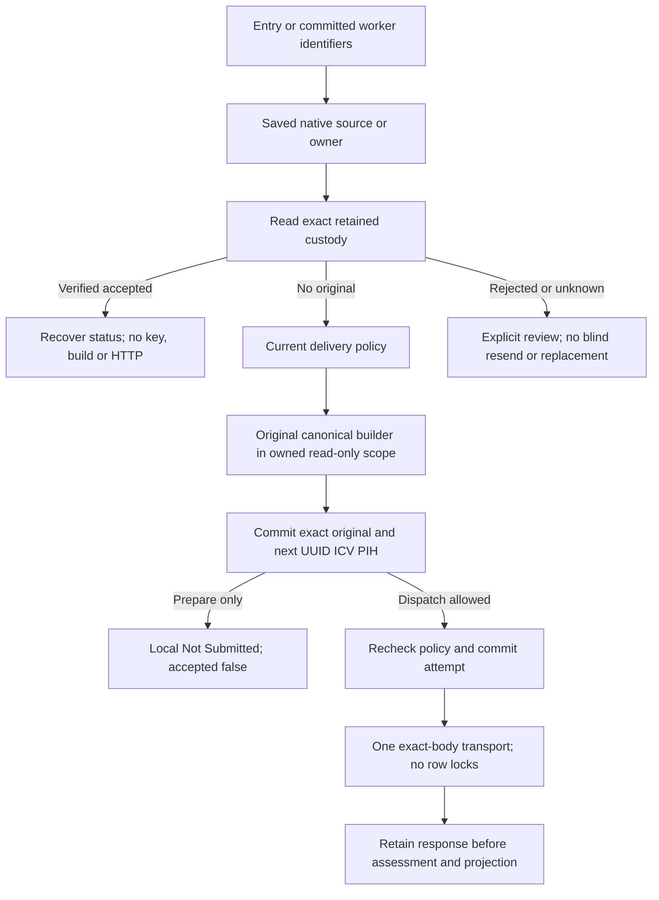

# Native entry, worker and delivery adoption

Workstream2 source development,2026-11-19. No live app/site/schema operation,
native activation or authority API call was performed. Default rollout is off.

## Adopted callsites

`native_provider.maybe_process_native_invoice` reloads the saved source and actual
Company/device/linked credential owner. Normal source READ+WRITE, Company READ
and selected-owner READ precede owned issuance. A source's native chain marker
also selects retained custody without requiring current owner credentials. A
native marker cannot fall back to legacy generation after rollout is disabled.
Unmarked legacy owners retain their existing path. Missing marker metadata is
inert; indeterminate/invalid native state is review, never a new registration.

The six production generator entries delegate to the facade after submit-hook
deferral and before their identity/party/counter pipeline:

| Module | Entry |
| --- | --- |
| sign_invoice | zatca_call |
| pos_sign | zatca_call |
| sales_invoice_withoutxml | zatca_call_withoutxml |
| zatca_background_sched | zatca_call_scheduler_background |
| pos_submit__without_xml | zatca_call_pos_without_xml |
| pos_schedule_background | zatca_call_pos_without_xml_background |

The callback is the entry's fixed server function. When called inside the owned
preparation ticket, the facade returns to its original canonical generator body;
it cannot recursively start another coordinator. Existing Compliance delegation
still happens first and Debug remains separate. No public callback/method-path,
credential, document object or caller acceptance flag is accepted or queued.

The deferred worker consults native custody before any legacy status-only skip.
Its native callback uses the original saved validator/route dispatcher with the
old Background early-return bypassed: delivery policy now owns that choice.
The unmarked legacy callback keeps its earlier behavior. Submitted background
collection entries use the fixed native dispatcher with a scheduled intent;
eligible unmarked entries retain their original callback. Submitted manual Sales/
POS collections use an explicit manual intent and return per-invoice outcomes.
The POS draft collection's incorrect Sales-variable reference was also corrected.

## One policy across generation and dispatch

| Document and intent | Result |
| --- | --- |
| Simplified, Live or empty legacy default | Prepare and dispatch |
| Simplified, Batches/Background, entry or deferred submit | Prepare only |
| Simplified, explicit submitted manual operation | Dispatch retained bytes |
| Standard, entry/submit/manual | Immediate configured operation; B2C method does not defer it |
| Scheduled operation | Current enabled Phase2 Company, Background method and current configured window required |

`native_delivery` holds a nonserializable, site/actor/source-bound execution
context. Its decision is recomputed from current saved Company/Customer rows
under shared NOWAIT locks before generation and attempt commits. The owned read
view downgrades FOR UPDATE to shared master reads. A changed mode/buyer/window
holds the operation; no DB row lock spans HTTP. The existing site-local inclusive/
overnight/two-window policy is reused. Unknown Simplified methods are review.
This is not another remote acceptance model or permission bypass.

Preparation now writes local `Not Submitted` and an empty response atomically
with first/replacement identity, after checking actual column capacity. Thus an
imported blank status can be discovered by the existing pending worker. This is
not an accepted status and changes no amount/tax/XML calculation. Verified
acceptance alone can subsequently project REPORTED/CLEARED. If projection fails,
the accepted receipt remains recoverable without rebuilding or sending again.

Before first native generation, an attached XML or Phase2 QR is an ambiguity
requiring review, not permission to infer zero or regenerate. Only the literal
DEBUG_ XML prefix is excluded, so Create XML for Debug output does not masquerade
as a historical fiscal original. No attachment is read/deleted/repaired here.
The selected owner marker must match the actual active chain; a different
active-owner slot cannot silently replace that pointer.

## Results and operator messages

The facade returns bounded English status/IDs/flags, never XML/token/key/raw
receipt. PREPARED means accepted=false. Rejected, stale, authentication and
unknown outcomes cannot become SUCCESS. An already verified accepted receipt
can recover despite an invalid current key or disabled rollout, without HTTP.
Rejected/in-flight/unknown/review custody is returned for explicit review;
ordinary/manual/background discovery cannot blindly retry it or mint a UUID.
The separate exact-retry/corrected-version services still need their operator
adoption; a generic resubmit button is not their authorization.

Child messages during owned work are muted request-locally and restored exactly.
A facade failure has one translated review and an English static-code diagnostic,
without stringifying raw child exceptions. Arabic display is in ar.csv. A failed
operator display is not evidence of remote rejection or permission to reissue.

## Evidence and acceptance still open

Focused local tests cover all six fixed-callsite handoffs, scheduled/manual
collection selection, policy windows/drift, contextual ownership, status
classification, retained recovery and message isolation. Private SQL tests
exercise six actual entry functions across Company/device/linked owners, their
actual API handoff, cryptographic custody, shared master locks, mode changes
before generation/reservation, cached key-loss recovery and bound303 fallback.
The two unit-specific non-background entries correctly reject a missing saved
device; they are not relabeled Company-capable to make a matrix pass.

Final evidence:314 focused local cases across5 suites in1.31s,188 private SQL
cases across6 suites in13.46s, and20,751 across the fixed81-suite issuer-binding
profile in115.06s. Logs are `/tmp/zatca-axis2-provider-local-final.log`,
`/tmp/zatca-axis2-provider-private-final.log` and
`/tmp/zatca-axis2-provider-regression-final.log`. The sets overlap. Manifest227
local/64 private suites was not run in full. The existing old-schema branch
fixture now declares its missing metadata explicitly instead of reaching an
uninitialized framework Meta loader. No financial expectation was rebaselined.

Private registration is explicitly preseeded active; no activation is proved or
performed. Their metadata stub supplies the existing synthetic UBL/signing builder
inside the actual entry's owned scope. This is not complete canonical ERP financial
generation, installed15/16, CA trust or SDK acceptance. Financial reference files
and the original240 comparison91/117/32 are unchanged.

Remaining workstream2 work includes actual initial/cutover activation and complete
legacy-consumer inventory/drain; four existing-XML admission paths; publication
compatibility/fiscal projection (first Desk/transient-print adoption is described
in [NATIVE_PUBLICATION.md](NATIVE_PUBLICATION.md)); explicit unchanged retry and
corrected-clock adoption; source
cancel/delete/rename decisions; and whole runtime qualification. Submitted manual
and scheduled adoption do not close draft-origin handoff: a scheduled/manual ERP
draft submission still defers through its ordinary submit intent first. The
existing24-hour discovery horizon and non-durable queue handoff are unchanged;
there is no outbox/restart-delivery guarantee. Installed/dummy-site rehearsals
retain their specific authorization gates. Workstream2 is not closed.
