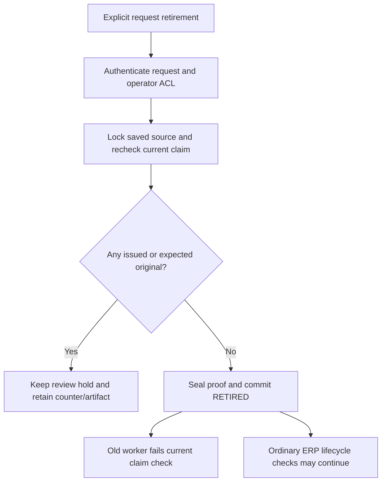

# Explicit retirement of unissued native requests

Workstream2 development,2026-11-21. Offline source only: no installed migration,
live operator action or authority request. Separate installed/dummy-company gates
and the seven-workstream sequence remain unchanged.

## Operator workflow

The readonly ZATCA Submission Intent form offers **Retire Unissued Request** to
System Managers for READY, WAITING, RUNNING and REVIEW. The normal DocType JS
path is used; local Frappe15 desk/form/meta.py loads that file without a global
asset hook. Confirmation captures record identity/state/fence, avoids dirty/
navigated forms and sends only those identifiers to a fixed POST method. One
translated result is shown; no generic save, queue action, invoice payload,
credential or caller-selected transport is supplied.

The server requires System Manager and current source READ+WRITE/Company READ,
including idempotent repeats. It authenticates the immutable request, acquires
only a clean owned transaction and locks the same source as native generation.
Current state/fence must match the reviewed Desk values. Normal ERP lifecycle
permissions, links and accounting checks still apply afterward.

Retirement is denied if any issuance exists for the source across chains/versions,
its saved egs marker remains, or its authenticated collection header previously
expected an original now missing. Age, a cleared UUID or an authority error never
proves nonissuance. Unsealed STAGED and completed COMPLETE are not admitted.
Missing sources/changed Companies remain review; status after later source
deletion/rename cannot bypass source ACLs.

## Durable proof and old-worker exclusion

Retirement retains the original header, ciphertext, actor, source key and claim
fence. It writes RETIRED, releases only a collection active slot, and seals an
independent intent-retirement AEAD capsule containing the original header hash,
request ID, prior state/fence, reviewing actor, server UTC clock and fixed reason.
The update is atomic. Stored proof is authenticated before COMMIT to detect
unreadable/truncated storage. Unknown commit acknowledgement is never compensated;
a later authorized read can identify the retained proof.

Original v1/v2 headers, payloads and financial/XML bytes are unchanged. The DocType
adds nullable hidden readonly retirement_header/retirement_ciphertext and terminal
RETIRED. No backfill, schema installation or migration occurs. RETIRED requires
authenticated proof; proof on another state is rejected too. Mutable state labels
or copied/damaged capsules cannot release a source.

Worker context carries its actual committed claim fence. Under generation and
attempt-reservation source locks it authenticates the current request and requires
RUNNING plus the same fence/header. Its shared request lock lasts through the owned
commit. Retirement takes the source lock and changes the request atomically; a
paused worker cannot later generate or reserve with a retired claim. Old queue
entries observe RETIRED; stale completion cannot overwrite it. No row lock spans
HTTP, and no queue lease timeout grants retirement or retry authority.

## Source lifecycle and verification

The retention guard admits a source with no issuance/egs marker only when all its
bounded request history is authentically RETIRED. It borrows the parent connection
to verify proofs without committing/rolling back ERP work. One active/unverified
request still holds the action. Over100 requests remains review rather than a
partial grant. Merge destinations receive the same inspection. Issued originals,
including rejected, uncertain and unsent PREPARED ones, remain retained. No ICV/
PIH is rewound, source repaired or invoice accepted.

Private SQL proves paused-worker exclusion, stale finish denial, role/source/write
permissions including repeats, original-header retention, v1/v2 and all owner
forms, multiple commands per source, lost custody, contradictory states, corrupted/
cross-domain proofs, parent write rejection and lost commit acknowledgement.
Synthetic Desk VM covers English/Arabic, role/state/dirty/navigation gates, expected
fences, terminal refresh and one result. Counts/logs are recorded in STATUS.md.
Accounting/signing/HTTP remain doubles; this is not installed acceptance.

Still open in2: reconcile started requests owning PREPARED/accepted or uncertain
issuance, complete Standard/non-Background recovery, unchanged retry and corrected
clock operator paths, historical inventory/drain and actual activation, frozen
print master/File consumers, whole canonical mixed runtime and installed ERP15/16/
GL/File lifecycle acceptance. This service resolves unissued request retirement;
it neither retries delivery nor implements an issued source correction/credit-note
workflow, and does not complete workstream2.
