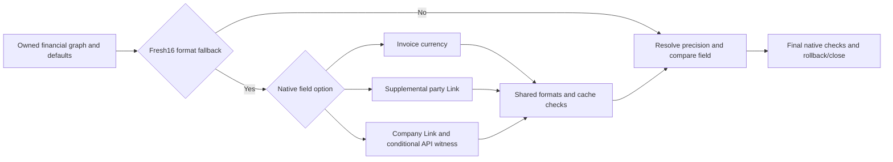

# Combined development batch 142–144 — owner currency and cache evidence

## Delivered together

This checkpoint completes three related DEV tasks: pinned upstream Currency
coverage auditing, native parent party-account currency, and the missing Company
API-cache projection. The shared link reader and parent scope registry keep
their common rules in one place. No installed source, schema, site, worker,
Company, credential or tax-authority operation is part of this checkpoint.

## 142: reproducible source coverage

`tests/erpnext_currency_fields_oracle.json` records seven public DocTypes per
version, source commit/path/full-file SHA256, selected Currency declarations and
the root party-currency Link. The existing native financial manifests are the
scope; custom application/site fields are not inferred from upstream JSON.

| Pinned source | Commit | Selected Currency fields |
| --- | --- | --- |
| Installed ERPNext15 source | 572d8530b6258231e31f294474cc1818f693d10b | 74 |
| Official ERPNext16 source | ade850bbd6a7412e9994a9637d2c5c713771632a | 74 |

Each version has36 invoice-currency options,32 Company-base options and6
party-account options. The latter cover total_advance/outstanding_amount on both
root invoice types, and advance_amount/allocated_amount on Sales Invoice Advance.
Both root party_account_currency fields are standard hidden/read-only Currency
Links; this work does not install a new field.

`PARENT_CURRENCY_SCOPES` in calculation_precision.py is the shared registry used
by acquisition, result field validation and the audit tool. It describes
parent.precision(field, parentfield), not direct-child row.precision semantics.

The read-only tool verifies all file hashes, reconstructs selected declarations
and checks the root party Link. From the DEV worktree, with bytecode disabled:

```sh
PYTHONDONTWRITEBYTECODE=1 PYTHONPATH="$PWD" ../../env/bin/python tools/audit_financial_currency_fields.py --source-root ../../apps/erpnext --erp-major 15
PYTHONDONTWRITEBYTECODE=1 PYTHONPATH="$PWD" ../../env/bin/python tools/audit_financial_currency_fields.py --source-root /tmp/zatca-financial-metadata-ade850bbd6a7 --erp-major 16 --flat
```

The second path is an explicit temporary public-source cache, not an installed
ERP16 site. The tool itself has no network/write/site discovery or arbitrary
metadata target. It rejects changed/unpinned files instead of silently updating
the oracle. Zero unsupported option names is source-pattern coverage, not proof
that every applied customization, provider or runtime calculation is supported.

## 143: supplemental native party currency

The existing capture_field_rounding_context API selects its source from native
field options only when fresh16 precision needs a format fallback:

| Option | Owner source | Native evidence |
| --- | --- | --- |
| currency | Root invoice currency | Existing financial header |
| Company:company:default_currency | Root Company base currency | Existing Company link read |
| party_account_currency | Root party-account currency | New supplemental root link read |

`OwnerCurrencyAcquisition` reuses the original NumericAcquisition graph. Normal
READ of party_account_currency, its definition and permission level precedes its
metadata callback. Pin original/fresh getters and declarations, and recheck
through cleanup. A new narrow OWNER_CURRENCY_PROFILE covers only this Link on
Sales/POS roots; it does not expand SOURCE_FIELDS or old financial profile bytes.

`LockedOwnerCurrencyRead` and MariaDBOwnerCurrencyReader specialize the existing
Company link validator/reader. Reuse its fixed bounded text query, CASE masking,
native type/length checks, exact metadata, transaction mode and failed-reader
rules. Only fixed DocTypes/field/profile strategies are allowed. Native proof
binds root name, revision, selected definition and the same DocType source row
as the financial parent. Missing/blank/unresolved links fail without guessing.

Pass that already read source to FormatAcquisition and bind it in the optional
SavedFieldCurrencyRead.owner_currency. A parent-owned advance field uses its
parent's party-account currency; it never borrows the child row's own Company or
the invoice currency just because the amounts happen to be equal. Final native
checks include the supplemental link on the SAME owned handle as defaults,
financial values, method and formats. No new transaction or cleanup engine.

## 144: Company API projection

Fresh native/normal Company equality does not prove the get_cached_value API's
projection. The trusted server constructor now accepts an optional
company_currency_cache_reader(scope, company_name). It is required for a fresh
Company-format branch when the owner's local field-currency slot is absent.
The supplied scalar must exactly match the native Company currency; None, blank,
wrong type or a stale currency is rejected without reset/refresh.

Retain the tagged Company projection in SavedFieldRoundingRead.company_cache,
reconstruct it against the exact Company/context and compare it before final
native checks and again after close. The reader must be a reviewed read-only
projection provider; this component never calls get_cached_value itself. A valid
local owner currency slot avoids the unused Company API provider; invalid or
blocked slots remain rejected. Configured precision,15 and non-Company scopes
skip this dependency. Absence never grants an invented matching projection.



## Evidence and remaining gates

See STATUS.md for exact affected-run counts. Both declared versions and normal
ACL signatures, Sales/POS, root/advance aliases, permissions, late mutations,
Company cache disagreement, caller-owned pending work and cleanup are rehearsed
using synthetic records and NEW guard-owned TCP-disabled MariaDB only. Three
guarded comparisons with the previous Company reader preserve exact payload and
fingerprint bytes. No installed16 boot, browser, SDK or remote acceptance follows.

Constructors validate supplied consistency, not independently proven provenance
or durable freshness. Actual controller identity/stage, API-provider provenance,
all-field batching/performance, unsupported applied option/currency patterns,
complete tax/discount/GL/VAT/advance/XML parity, whole-worker/custody integration
and caller/dead-code/installed15/16/SDK gates remain before separately approved
fictional-Company rehearsal and adoption/cancellation. All authority sending
remains prohibited, including Sandbox/Simulation/Compliance.
