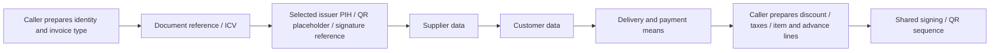

# Shared invoice reference and party sequence — increment199

Increment200 additionally shares the following allowance/tax composition while
preserving nominal read timing, actual builder algorithms and caller-owned
item/advance selection. See [DOCUMENT_TAX_SEQUENCE.md](DOCUMENT_TAX_SEQUENCE.md).

Development only. Ten existing generator spans now use one reference/party/
payment sequence in `invoice_party_xml.py`. This does not install the branch or
authorize any authority request, including Compliance or synthetic onboarding.

## Flow and ownership

`PartyXmlTools` binds exactly five existing adapter functions for the explicitly
declared Sales/POS adapter and preparation purpose. It retains no namespace,
document, credential or issuer material. Each operation's returned XML root is
passed to the next, including when a supported override replaces that root.
Functions are bound per invocation, preserving existing imported override points.
This is neither a new saved-source/permission policy nor an atomic snapshot.

`populate_invoice_parties` owns only the order and argument handoff. It does not
import Frappe, load records, allocate identities itself, calculate amounts,
choose credentials or routes, write files, log, display or send. Existing
callbacks still perform their previous reads and legacy reference/counter work.

## Purpose matrix

| Purpose | Reference builder and arguments | Payment builder and final argument |
| --- | --- | --- |
| `invoice` | Existing `doc_reference(root, source, number)`; omit Debug keyword | Existing Sales/POS ordinary payment function; read `source.is_return` after customer data |
| `debug` | Existing ordinary reference with explicit `debug=True` | Existing ordinary payment function and late `is_return` |
| `compliance` | Existing `doc_reference_compliance` with the explicit sample code | Existing Sales/POS Compliance payment function with the same sample code; do not read `is_return` |

Sales keeps the `delivery_and_payment_means` spelling; POS keeps
`delivery_and_paymentmeans`. Compliance chooses the corresponding existing
`_for_compliance` function. Mode selection cannot switch credential owners,
environments or submission endpoints. Unknown modes/adapter declarations and
noncallable tools fail with static English programmer-error codes.

The supplied source, caller's invoice number and Company abbreviation remain
exactly those used before extraction. The abbreviation is not reloaded or
substituted by this stage. Supplier/customer address, aliases, name order, tax
identifiers, Cost Center and other settings remain in the existing builders.
Sales/POS content differences are preserved, not silently normalized.

## Caller map

| Module | Migrated call sites | Purpose |
| --- | --- | --- |
| `sign_invoice` | `zatca_call`, `zatca_call_compliance` | `invoice`, `compliance` |
| `pos_sign` | `zatca_call`, `zatca_call_compliance` | `invoice`, `compliance` |
| `sales_invoice_withoutxml` | `zatca_call_withoutxml` | `invoice` |
| `zatca_background_sched` | `zatca_call_scheduler_background` | `invoice` |
| `pos_submit__without_xml` | `zatca_call_pos_without_xml` | `invoice` |
| `pos_schedule_background` | `zatca_call_pos_without_xml_background` | `invoice` |
| `debug_xml` | Nested generator in `_debug_call` | `debug` |
| `pos_debug_xml` | Nested generator in `_debug_call` | `debug` |

Type classification, ordinary/sample diversion, actual UUID/ICV policies,
discount/tax/nominal branches, advance item selection, signing, artifact handling,
dispatch, scheduling, exception/display ownership and public API signatures stay
in their existing adapters. All imported legacy functions remain available at
their prior paths; no public compatibility function or runtime file was retired.

The Company-only automatic onboarding builder remains separate. It does not
gain a requirement for a saved customer or Sales/POS Invoice. Ordinary Phase-1
five-tag QR also remains on its existing path.

## Offline evidence

`test_invoice_party_xml.py` adds **164 cases**:

- 96 real builder parity cases: Sales/POS × ordinary/Debug/six sample codes ×
  Company/device/linked issuer × SAR/USD. Old direct calls and the shared
  sequence produce identical XML bytes, record-read calls/order and ICV-purpose
  arguments. Synthetic saved records and an explicit counter stub are used;
  no actual issuer counter is allocated.
- 12 return/debit/advance header characterizations preserve existing per-adapter
  billing references and payment notes. These test this header stage, not full
  advance accounting, eligibility or note-type correctness.
- 18 missing selected-PIH cases stop before supplier/customer/payment, without
  a Company fallback or invented genesis. The preceding legacy reference/ICV
  call still happens; this extraction does not make that sequence atomic.
- Returned-root replacement, exact function/argument order, late return-flag
  consumption, Compliance without `is_return`, failure propagation/stopping,
  configuration checks and frozen per-invocation binding complete the selection.

Final guarded selection: **5,168 distinct local cases passed across 34 reviewed
suites**, including those 164 new cases. It covers previous signing/QR parity,
all six samples and issuer modes, Debug/Compliance isolation, source ownership,
tax-detail compatibility, routing, settings, scheduling, Phase-1/Phase-2 and
advance artifact preservation, messages and offline guard behavior. Initial
overlapping 4,815/146-case runs are not added to the final count. Final log:
`/tmp/zatca-party-xml-regression-final-199.log`. The fixed manifest now has 169
local and 57 private suites; this was not a whole-manifest or native SQL run.

AST review against `da4beaa08c9dcddd2cc278f1496f78d6f38e098e` normalized only the
ten old/new spans and the added imports. Every other node in the eight adapters
matched. Review additionally checked each span's source/number/abbreviation,
declared adapter/mode and Compliance-code bindings. Tool:
`/tmp/zatca_party_structure_199.py`; report:
`/tmp/zatca-party-structure-199.json`. The actual Sales/POS XML builder modules
are unchanged. No performance or source-size reduction is inferred from this
structural consolidation.

## Remaining gates

Fiscal correctness, full GL/VAT/XML/QR reconciliation, effective settings/alias
consistency, ICV/PIH atomicity and historical continuity, authority SDK acceptance,
installed ERPNext/Frappe 15/16 and the separately approved fictional-client
rehearsal remain required. Matching inherited outputs does not certify those
outputs or close the complete preparation/runtime migration.

No live source, configuration, schema, customer data, Bench or worker changed;
no authority request occurred. The existing unrelated live tooltip edit was
preserved. Existing aggregate translation/logging ownership was not replaced.
