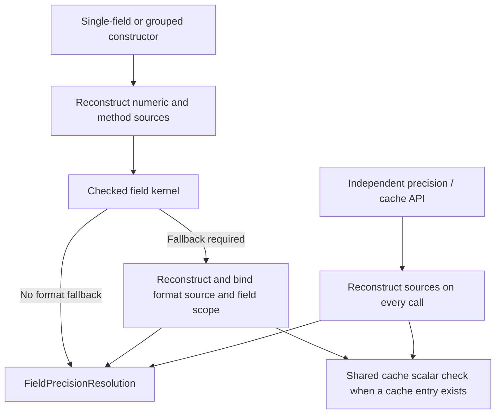

# Precision resolution on checked sources — increment 196

This development-only bundle continues performance, shared logic, testing and
diagnostic improvements. It changes no installed source, tenant data, settings,
invoice amounts, Bench/workers or authority endpoint.

## Reuse the precision rule, preserve independent source validation

The single-field constructor and grouped stage already reconstruct their
numeric/method sources before entering `_resolve_field`. Previously that kernel
called the standalone financial precision API, which reconstructed the invoice
again before constructing `FieldPrecisionResolution`.

The kernel now constructs the same `FieldPrecisionResolution` directly from
its checked field metadata, captured defaults and matching ERP major. That
constructor independently validates the consumed metadata/defaults/context and
retains the same precision, origin and fingerprint rules. No caller-supplied
precision or prevalidated-source flag is accepted.

For v16 fallback, `SavedFieldCurrencyRead` is still fully reconstructed and
matched to the numeric financial source first. Its `_field` check still binds
the root/child field to invoice, company or party currency scope. Only then is
the same precision rule constructed with its checked format context.

One pure `_require_cached_field_currency` comparison is shared by the checked
kernel and independent cache-check API. It neither acquires nor validates a
source itself; both callers perform their source and field-scope checks first.
The public financial and format precision APIs still reconstruct independently
on every call. A previous success cannot hide later source corruption.

There is no global cache, source mutation or changed rounding policy. Float and
Decimal boundaries, the individual/grouped field kernel, cache ownership and
all 25 calculation capture entry points retain their existing contracts. No UI
messages were added; existing Arabic display/English diagnostic behavior stays
on the shared boundary.

## Supporting diagnostic improvement

One initial connected POS/return selection failed during NEW MariaDB bootstrap,
before any calculation test ran. Disk/inode space was available. The old fixture
discarded its owned installer log on cleanup, so the original exit 1 cause could
not be recovered. The reviewed selection was repeated with fresh isolated data;
it was not marked passing on the basis of that failed setup.

The fixture now includes only the final 4,096 bytes of its own installer log in
an install-exit/timeout failure. It still fails the test and has no automatic
retry or validation suppression. Local diagnostic tests simulate both failures,
need no native binaries, register no permitted command and start no subprocess.
No production/server/site log is opened by this diagnostic path.

The configured-advance precision test now counts actual
`FieldPrecisionResolution` construction rather than an adapter call that the
checked header no longer needs. Its expectation remains one fresh header rule
and one shared configured-row rule. This retains the original behavioral check.

## Measurements

Baseline: `124a678`. Historical/current kernels run in alternating order on the
same synthetic inputs; temporary patches are confined to the benchmark process
and restored in `finally`. Result values and precision fingerprints must match.
The two-field stage and cached-currency field benchmarks measure specific
reconstruction workloads, not installed invoice latency or process RSS.

| Controlled workload | Before | After | Interpretation |
| --- | --- | --- | --- |
| Two-field stage CPU median, three reconstructions, first fixture | 0.390562s | 0.200154s | 48.8% less CPU for this workload |
| Same stage, second permission-signature fixture | 0.647249s | 0.335395s | 48.2% less CPU |
| Cached-format field CPU median, three reconstructions | 1.099559s | 0.550519s | 49.9% less CPU |
| One stage reconstruction, Python peak allocations | 1,681,864–1,685,163 bytes | 1,280,501 bytes | 23.9–24.0% lower scoped observed peak |
| One cached-format field, Python peak allocations | 2,476,528 bytes | 1,791,840 bytes | 27.6% lower scoped observed peak |
| Same complete ERP15 synthetic chain selection, one run per revision | 124.98s | 73.33s | 41.3% shorter for this selected offline case |

The A/B stage fixtures use ERP major 16 observations with two permission-signature
variants; the cached-format field uses a synthetic invoice-currency source.
These do not constitute two installed ERP runtimes. Numbers are not process RSS,
production throughput or guarantees for other invoices. The connected inspection
remains expensive and off invoice-save/polling paths.

The initial cProfile pair reduced financial-read constructor calls from 16 to 9.
Its total wall time increased from 8.29s to 9.27s under different parallel test
load; this pair is not used to claim an end-to-end speedup. The controlled A/B
and complete selected test are reported separately above.

## Reviewed validation

**1,036 distinct cases passed: 983 local and 53 private SQL, including 54 new
cases.** The node list was deduplicated. Failed initial runs, partial runs and
overlapping profiling/A/B probes are not added to the count. The fixed manifest
now contains 166 local and 57 private suites; only these reviewed selections ran.

| Selection | Result | Evidence |
| --- | --- | --- |
| New direct/independent precision parity and revalidation contracts | 52 passed /41.77s | `/tmp/zatca-precision-contract-196.log` |
| Ordinary/format-dependent field reads and format access, including Arabic display | 538 passed /276.49s | `/tmp/zatca-precision-field-local-196.log` |
| Shared stage contracts and actual15/pinned16 probes | 218 passed /242.27s | `/tmp/zatca-precision-stage-local-196.log` |
| Aggregates, configured advance precision and numeric views after observer update | 170 passed /165.28s | `/tmp/zatca-precision-math-local-final-196.log` |
| Pure installer diagnostics and offline manifest | 5 passed /0.41s | `/tmp/zatca-precision-diag-manifest-final-196.log` |
| Native ordinary15/16 connected chains | 2 passed /234.21s | `/tmp/zatca-precision-native-ordinary-196.log` |
| Native foreign return16 and consolidated POS15 after bootstrap retry | 2 passed /174.61s | `/tmp/zatca-precision-native-pos-final-196.log` |
| Native guards, limits, empty/cancelled invoices and drift rejection | 7 passed /346.17s | `/tmp/zatca-precision-native-guards-196.log` |
| Native stage query counts, formats, locks and cleanup | 42 passed /72.44s | `/tmp/zatca-precision-native-stage-196.log` |

The final complete-chain measurement also passed against the updated installer
fixture in 73.33s (`/tmp/zatca-precision-after-196.log`); it overlaps the ordinary
cases above. The A/B measurement's three cases likewise overlap the reviewed
set. Parallel suite durations must not be summed into invoice latency claims.

## Acceptance and remaining work

Review ordinary and format-dependent precision parity for Sales/POS parents and
children, presence/absence of currency caches, independent API revalidation,
Arabic aggregate failures, actual15/pinned16 stage probes, advance aggregation,
all connected settlement scenarios and native stage locking/drift/cleanup.
Repeated measurements and test reruns must be deduplicated in reported counts.

All 25 calculation capture method bodies match `124a678`. The private diagnostics
tests simulate exit/timeout failure without native binaries or a permitted
command. Changed Python parses and `git diff --check` passes. The live address
hotfix source retains SHA256
`d4360df7195ac4e3e63d74f005c000a3adadaa55caa7681cd1de1b058d4f7f01`;
the pre-existing live tooltip change is preserved outside this DEV bundle.

The fixed offline manifest and no-authority-request ban remain. The combined
inspection is still not installed on save/polling paths. Further graph-level
cost reduction, full accounting/VAT/XML/QR/SDK reconciliation, installed15/16
acceptance and separately approved fictional-client rehearsal remain open.
