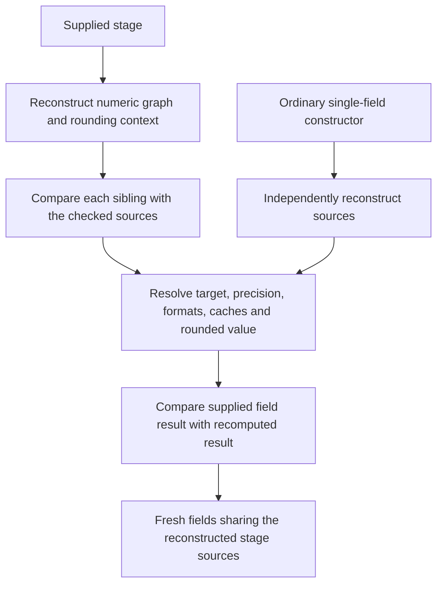

# Shared rounding stage reconstruction — increment 195

This development-only bundle continues the performance and maintenance work
required in [ENGINEERING_QUALITY.md](ENGINEERING_QUALITY.md). It changes neither
installed code nor invoice amounts/settings, and makes no authority request.

## One shared source reconstruction, independent field checks

Previously a stage reconstructed its numeric graph and rounding context, then
each sibling field reconstructed those same sources again. Every later stage
pin repeated that pattern. The grouped boundary now reconstructs the numeric
graph and method once, compares each supplied sibling with those freshly
reconstructed sources, and independently resolves every field.

The ordinary `SavedFieldRoundingRead` constructor and grouped reconstruction
share `_resolve_field`. It retains the target, owner, precision, format/cache
and exact rounding checks. Currency-format evidence is still independently
reconstructed where required; this bundle does not optimize it away.

The supplied numeric graph and method are ALWAYS reconstructed at the grouped
entry point. There is no trusted flag, prevalidated argument or cross-call
cache. Typed comparison includes every dataclass constructor input and comparable
derived field. Exact scalar types and float zero signs are preserved. Only
non-comparable derived caches are excluded; the result uses rebuilt caches
rather than retaining the supplied caches.

The grouped function creates fresh immutable field objects only after source
equivalence and field resolution succeed, then checks every supplied result.
It explicitly initializes every declared dataclass field; adding a field without
updating this construction fails closed. The normal constructor continues to
validate independently. No unvalidated result-construction API is exposed.

Fields in one returned stage now intentionally share that stage's reconstructed
numeric/method objects. They do not retain the supplied field objects. Separate
stage pins reconstruct afresh, so later changes are checked again. This is
consistency evidence, not trusted acquisition, controller execution or an
accounting/dispatch grant.

## Maintenance and compatibility

The numerical kernel has one implementation. `MAX_STAGE_FIELDS` has one
definition, and the obsolete private `_pin_field` wrapper and its unused class
import were removed. A search of the baseline repository showed that wrapper's
only caller in the stage constructor; it was not a registered entry point.

All 25 existing calculation capture method bodies remain unchanged. No new UI
strings were added. Existing aggregated translated display and English internal
diagnostics remain in use. Owned acquisition, callback ordering, permission,
native-source and post-close checks are unchanged.

## Measurements and limits

Baseline: `db371e9`. Temporary measurement scripts run only on synthetic data
under the offline guard, outside runtime hooks. Historical/current methods are
switched only inside the measurement process and restored in `finally`.

In an alternating A/B benchmark of the same two-field stage, the median CPU
time for three reconstructions dropped from 0.726155s to 0.373624s in one fixture
and from 0.728329s to 0.370283s in the other: **48.5–49.2% less CPU**. Both are
synthetic permission-signature fixtures using ERP major 16 observations, not
two installed ERP runtimes. Results, precision hashes and float bits matched.

Single-reconstruction tracemalloc peaks in those fixtures changed from
3,129,723 to 1,690,895 bytes and from 3,133,027 to 1,728,632 bytes: **44.8–46.0%
lower observed peak allocations**. These are scoped Python observations, not
process RSS, database memory or production invoice-memory measurements.

The same single-stage cProfile selection reduced numeric constructors from 13
to 8; total profiled time was 7.67s before and 6.69s after. The final complete ERP15 synthetic chain selection decreased from 213.12s to
119.01s (44.2%). This is one selected offline case, not an invoice latency or
throughput guarantee. Other final selections are recorded below.

The connected inspection remains expensive. This is not permission to put it
on invoice save/polling or a claim about production throughput. Reducing other
repeated graph/format reconstruction, installed 15/16 lifecycle acceptance and
the full GL/VAT/XML/QR/SDK gates remain open.

## Validation

**864 distinct cases passed: 811 local and 53 private SQL, including 44 new
cases.** Selected node IDs were deduplicated. The A/B probes, initial smoke
runs and repeated profiling/complete-chain selections overlap these cases and
are not added to the total. The fixed manifest has 164 local and 57 private
suites; only the reviewed selections below were executed.

| Reviewed selection | Result | Evidence |
| --- | --- | --- |
| Grouped contracts, stage projection and actual15/pinned16 probes | 218 passed /323.13s | `/tmp/zatca-stage-batch-stage-local-195.log` |
| Ordinary single-field and format-dependent reads | 420 passed /333.49s | `/tmp/zatca-stage-batch-field-local-195.log` |
| Aggregates, advance rounding and numeric views | 170 passed /322.76s | `/tmp/zatca-stage-batch-math-local-195.log` |
| Fixed manifest | 3 passed /0.06s | `/tmp/zatca-stage-batch-manifest-195.log` |
| Connected ordinary15/16 cases | 2 passed /377.44s | `/tmp/zatca-stage-batch-native-ordinary-195.log` |
| Connected foreign return16 and consolidated POS15 | 2 passed /342.75s | `/tmp/zatca-stage-batch-native-pos-195.log` |
| Connected guards, limits, empty/cancelled invoices and drift rejection | 7 passed /608.57s | `/tmp/zatca-stage-batch-native-guards-195.log` |
| Native stages: query counts, formats, drift, locks and owned cleanup | 42 passed /84.34s | `/tmp/zatca-stage-batch-native-stage-195.log` |

The final A/B probe passed its two overlapping selected cases and recorded the
CPU/allocation figures above in `/tmp/zatca-stage-ab-195.json`. The final
complete-chain measurement passed in 119.01s in
`/tmp/zatca-stage-batch-final-195.log`. Group suites ran concurrently; their
durations must not be summed into a user-facing latency claim.

New cases compare grouped results with independent constructors for Sales/POS parents
and children, reject changed sibling sources/types/caches/results, preserve
float zero signs, rebuild derived metadata caches without repairing inputs,
and verify that each new stage pin independently reconstructs its numeric root.

The reviewed regressions include actual 15/pinned 16 stage probes, ordinary and
format-dependent single-field reads, aggregate/advance/numeric-view contracts,
all connected advance-settlement cases and native stage locking/drift/cleanup.
These are offline comparisons, not installed16 or fiscal acceptance evidence.

Changed Python files parse and `git diff --check` passes. All 25 capture method
ASTs match `db371e9`. The live address source retains SHA256
`d4360df7195ac4e3e63d74f005c000a3adadaa55caa7681cd1de1b058d4f7f01`.

No working-site source/configuration/schema/data or Bench/worker process was
changed. Preserve the pre-existing live `customer_zatca_tooltips.js` change and
the current isolated-development/rehearsal restrictions.
