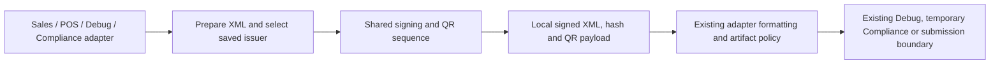

# Shared in-memory signing sequence — increment197

Increment200 shares the preceding document allowance/tax composition across ten
generator contexts without changing actual tax algorithms or item/advance
selection. See [DOCUMENT_TAX_SEQUENCE.md](DOCUMENT_TAX_SEQUENCE.md).

Increment199 additionally shares the preceding invoice reference/party/payment
sequence at the ten existing ordinary/Compliance/Debug call sites. Monetary
preparation and signing policy remain in their existing owners. See
[PARTY_XML_SEQUENCE.md](PARTY_XML_SEQUENCE.md).

Increment198 moves `encode_qr_payload` unchanged to the pure `qr_encoding`
module. Its import here remains a compatibility alias. Phase-1 uses a separate
five-tag text encoder, preserving Phase-2's existing binary/long-tag policy.
See [QR_SERIALIZATION.md](QR_SERIALIZATION.md).

This development bundle consolidates existing runtime call sites in the isolated
branch. It does not install that branch, change a tenant or contact any authority
environment. It does not adopt the expensive saved-calculation inspectors on an
invoice-save path.

## Ownership and flow

`signed_xml_pipeline.sign_invoice_xml` now owns the repeated exclusion,
canonicalization, hash, signature, certificate/property population, TLV encoding
and QR embedding sequence. `SigningTools` binds only the twelve existing
operation functions from the calling adapter. It does not retain the module
namespace, source document or credential values; functions are rebound for each
invocation, preserving existing imported compatibility/override points. This is
not an atomic credential snapshot or a new credential-source policy.

`SignedInvoiceXml` returns the same unformatted XML, encoded invoice hash and QR
payload; its representation omits artifact content. The caller still owns final
formatting, file lifetime, attachment behavior, API choice, status handling and
exceptions. An artifact is not evidence of authority receipt or acceptance.

## Caller map

| Module | Migrated entry points | Existing final boundary |
| --- | --- | --- |
| `sign_invoice` | `zatca_call`, `zatca_call_compliance` | Existing ordinary writer/submission or temporary Compliance file |
| `pos_sign` | `zatca_call`, `zatca_call_compliance` | Existing POS writer/submission or temporary Compliance file |
| `sales_invoice_withoutxml` | `zatca_call_withoutxml` | Existing Sales without-XML writer/dispatch |
| `zatca_background_sched` | `zatca_call_scheduler_background` | Existing Sales preparation/deferral |
| `pos_submit__without_xml` | `zatca_call_pos_without_xml` | Existing POS without-XML writer/dispatch |
| `pos_schedule_background` | `zatca_call_pos_without_xml_background` | Existing POS preparation/deferral |
| `debug_xml` | `debug_call` nested generator | Formatted memory content and permissioned Debug attachment |
| `pos_debug_xml` | `debug_call` nested generator | Formatted memory content and permissioned Debug attachment |

Ten full copies were replaced. Adjacent commented intermediate-file bridges and
two obsolete Debug `base64` imports were removed. All existing signing imports
remain available at their previous module paths; this bundle does not retire a
public compatibility function or remove a runtime file.

Automatic Company onboarding reuses only `encode_qr_payload`. Its synthetic XML
builder, Company source, initial-hash policy, final-hash stabilization and
temporary-file boundary remain separate. Ordinary Phase-1 five-tag generation
and advance QR amount calculations retain their existing paths. No Phase-2
signing dependency is added to Phase-1 QR generation.

## Behavior deliberately preserved

- Same twelve operation calls and their order, with the same Company abbreviation
  and source object passed to every applicable operation.
- Existing certificate/property digest, signature and canonicalization rules.
  This extraction is not a normative review or fix of those rules.
- Producer insertion order for QR tags, UTF-8 and binary values, including the
  current long-string TLV representation; no sorting or new encoding policy.
- Formatting after signing at the original adapter boundary. No additional
  pretty-printing or serialization round trip is introduced by the shared code.
- Existing Sales/POS/advance type, tax/discount/item preparation, aliases,
  settings precedence, saved issuer, compliance diversion, scheduling and
  retry/identity behavior.
- Existing exception identity at the shared helper boundary. Later operations
  stop when an earlier stage fails; outer compatibility handlers still own
  logging/display. Existing aggregate display and English diagnostic policies
  are not replaced by a second popup or new translation key.

The helper does not import Frappe, HTTP, database, file or image libraries.
Injected legacy functions still perform their existing credential reads; this
does not prove atomicity across those reads or cure legacy partial effects.

## Offline verification

The new `test_signed_xml_pipeline.py` has **59 cases**:

- 36 real XML/crypto parity cases: six document types × Sales/POS sources ×
  Company, own-device and linked-Company certificate ownership. The frozen
  former sequence from `f29bdde` and the shared sequence produce identical XML,
  encoded hash and QR bytes with the same test-only signature. Each signature
  is independently verified with the selected ephemeral certificate's public
  key; QR/date/hash/signature/certificate correspondence and final formatting
  are checked. No private test key is written to disk.
- 12 failure-injection cases, preserving the original exception and preventing
  subsequent stages from running.
- Per-invocation function binding, no namespace/owner retention, frozen/redacted
  result, invalid operation setup and six ordered/Arabic/binary/boundary TLV cases.

The final reviewed guarded selection passed **4,384 distinct local cases** across
28 suites, including these 59 new cases. The initial five-suite selection passed
1,030 and the initial new-suite run passed 58; those overlapping runs are not
added to the final count. No private SQL fixture was needed. The manifest now
contains 167 local and 57 private suites; this bundle did not run every suite.
Final log: `/tmp/zatca-shared-signing-regression-final-197.log`.

An AST comparison against `f29bdde328fff8ad20c740e02a3314bc129fa79e` replaced
only the ten old/new signing spans, the one onboarding QR expression and the
corresponding imports with matching markers. Every other node in the eight
adapter modules matched, including public signatures/decorators, tax preparation,
settings/routing, writers and exception handlers. Review output is in
`/tmp/zatca-signing-structure-197.json`; the local comparison script is
`/tmp/zatca_signing_structure_197.py`. Including the new shared runtime module,
the affected runtime source has **222 fewer lines**. This is a source-size
measurement, not a CPU, memory, query-count or invoice-latency improvement claim.

## Release limits

Passing parity preserves inherited behavior, including its limitations. Full
accounting/VAT/XML reconciliation, authority SDK/signature acceptance, first-chain
and retry/rotation guarantees, complete runtime consolidation, installed 15/16
acceptance and separately approved fictional-client rehearsal remain open.
Python-only orchestration is compatible with the declared Python baseline;
these tests do not boot installed ERPNext/Frappe 15 and 16.

No live source, settings, schema, data, worker or Bench process was changed.
The live worktree's pre-existing tooltip modification was preserved. No OTP,
CSID, Compliance, reporting, clearance or other authority request occurred.
